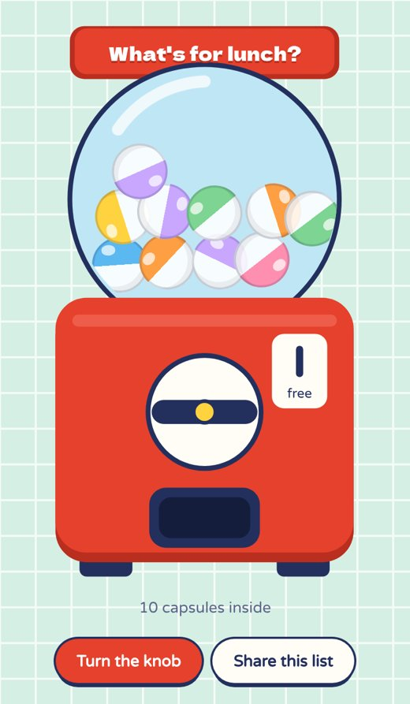
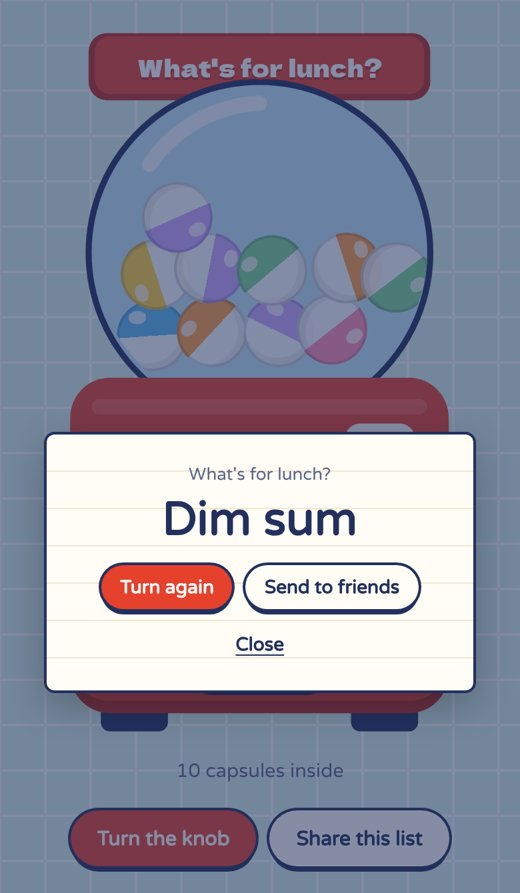

# Gacha Pick 🎰

**English** | [繁體中文](README.zh-Hant.md) | [简体中文](README.zh-Hans.md)

**Can't decide? Turn the knob.**

A capsule-toy machine that decides for you: what to eat, where to go, who washes the dishes. Turn the knob, a capsule drops out, open it and your answer is inside.

**▶ Try it: https://tllct122.github.io/gacha-pick/**

  
  

## Features

- 🎰 **A real-feeling machine**: the knob turns, the capsules rattle, one drops into the chute with a thunk, and it pops open with your answer. Sound and phone vibration included
- ✏️ **Your own machines**: make as many as you like, like "What's for lunch?" or "Who pays?". Type one option per line, in any language
- 🙅 **No repeats**: turn this on and nothing comes out twice until the machine is empty. Good for taking turns
- 🔗 **Share a machine**: send a link and your friends can turn the same machine on their phone, or add it to their own
- 📲 **Works like an app**: add it to your home screen, and it works offline. No account, no ads, and everything stays on your phone

## Use it

| To | Do this |
|---|---|
| Get an answer | Tap **Turn the knob** (or the knob itself), then tap the capsule |
| Make your own machine | **+ New machine**, give it a name, and type what's inside, one per line |
| Send to a group chat | **Share this list**, or **Send to friends** after opening a capsule |
| Put it on your home screen | iPhone: Share → **Add to Home Screen**. Android: ⋮ → **Install app** |

## Support

If Gacha Pick ended a "whatever, you choose" argument, you can support it here:

- ☕ Buy Me a Coffee: https://buymeacoffee.com/sirene122

## License

[MIT](LICENSE)
