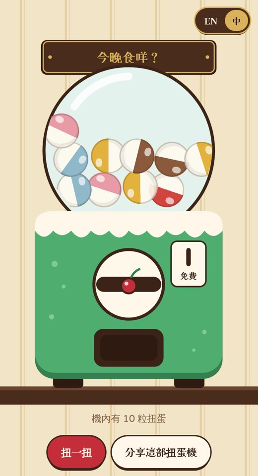
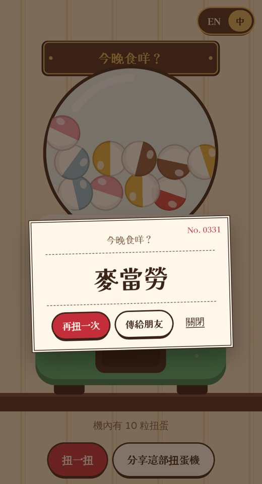

# Gacha Pick 🎰

[English](README.md) | [繁體中文](README.zh-Hant.md) | **简体中文**

**决定不了？扭一扭。**

一台昭和复古喫茶店风格、帮你做决定的扭蛋机：吃什么、去哪里、谁洗碗。扭一下，扭蛋掉出来，打开就是答案。

**▶ 立即试玩：https://tllct122.github.io/gacha-pick/**

  
  

## 功能

- 🎰 **像真的扭蛋机**：转动旋钮、扭蛋摇动、“咚”一声掉进出口、打开就是答案。有音效和手机震动
- ✏️ **自己的扭蛋机**：想开几台都可以，例如“今晚吃什么？”、“谁请客？”。每行一个选项，任何语言都可以
- 🙅 **不重复**：开启后，扭完所有扭蛋之前不会出现重复的答案，适合轮流
- 🔗 **分享扭蛋机**：发一条链接，朋友就可以在手机扭同一台机，或添加到自己那里
- 🌏 **中文／English**：右上角一键切换
- 📲 **像 app 一样用**：添加到主屏幕，没网络也能用。不用登录、没有广告，所有数据只留在你的手机

## 使用方法

| 想要 | 做法 |
|---|---|
| 得到答案 | 点 **扭一扭**（或直接点旋钮），然后点扭蛋 |
| 开自己的扭蛋机 | **+ 新扭蛋機**，改名，再每行输入一个选项 |
| 发到群聊 | **分享這部扭蛋機**，或打开扭蛋后点 **傳給朋友** |
| 添加到主屏幕 | iPhone：分享 → **添加到主屏幕**。Android：⋮ → **安装应用** |

## 支持

如果 Gacha Pick 帮你结束了一次“随便啦，你选”，欢迎在这里支持：

- ☕ Buy Me a Coffee：https://buymeacoffee.com/sirene122

## 许可证

[MIT](LICENSE)
