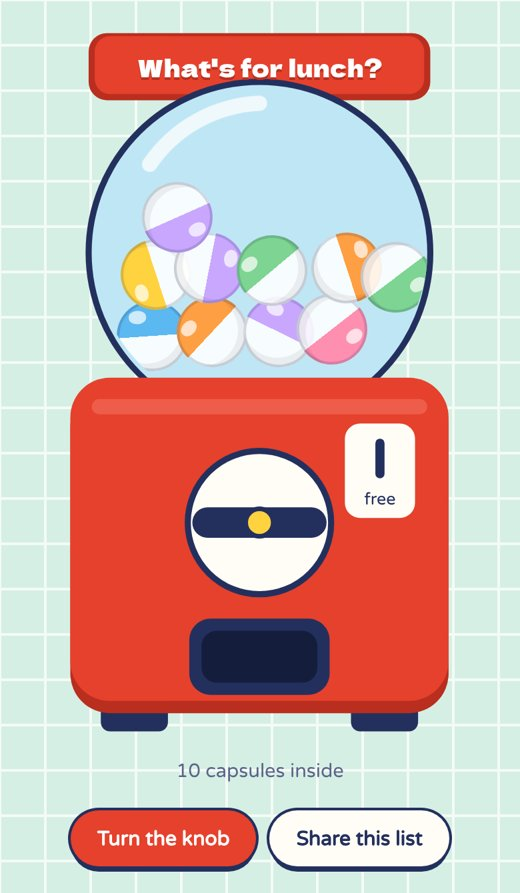
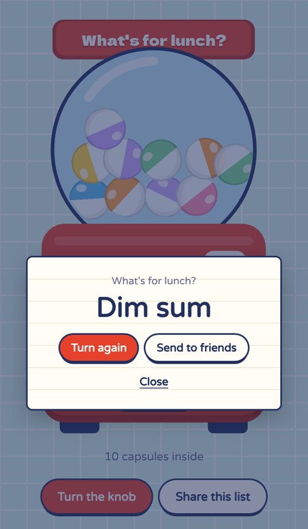

# Gacha Pick 🎰

[English](README.md) | **繁體中文** | [简体中文](README.zh-Hans.md)

**決定不了？扭一扭。**

一部幫你作決定的扭蛋機：食甚麼、去哪裡、誰洗碗。扭一下，扭蛋掉出來，打開就是答案。

**▶ 立即試玩：https://tllct122.github.io/gacha-pick/**

  
  

## 功能

- 🎰 **像真的扭蛋機**：扭動旋鈕、扭蛋搖動、「咚」一聲掉進出口、打開就是答案。有音效和手機震動
- ✏️ **自己的扭蛋機**：想開幾部都可以，例如「今晚食咩？」、「邊個請？」。每行一個選項，任何語言都可以
- 🙅 **不重複**：開啟後，扭完所有扭蛋之前不會出現重複的答案，適合輪流
- 🔗 **分享扭蛋機**：傳一條連結，朋友就可以在手機扭同一部機，或加到自己那裡
- 📲 **像 app 一樣用**：加到主畫面，沒網絡也可以用。不用登入、沒有廣告，所有資料只留在你的手機

## 使用方法

| 想要 | 做法 |
|---|---|
| 得到答案 | 點 **Turn the knob**（或直接點旋鈕），然後點扭蛋 |
| 開自己的扭蛋機 | **+ New machine**，改名，再每行輸入一個選項 |
| 傳到群組 | **Share this list**，或打開扭蛋後點 **Send to friends** |
| 加到主畫面 | iPhone：分享 → **加入主畫面**。Android：⋮ → **安裝應用程式** |

## 支持

如果 Gacha Pick 幫你終結了一次「求其啦，你揀」，歡迎在這裡支持：

- ☕ Buy Me a Coffee：https://buymeacoffee.com/sirene122

## 授權

[MIT](LICENSE)
